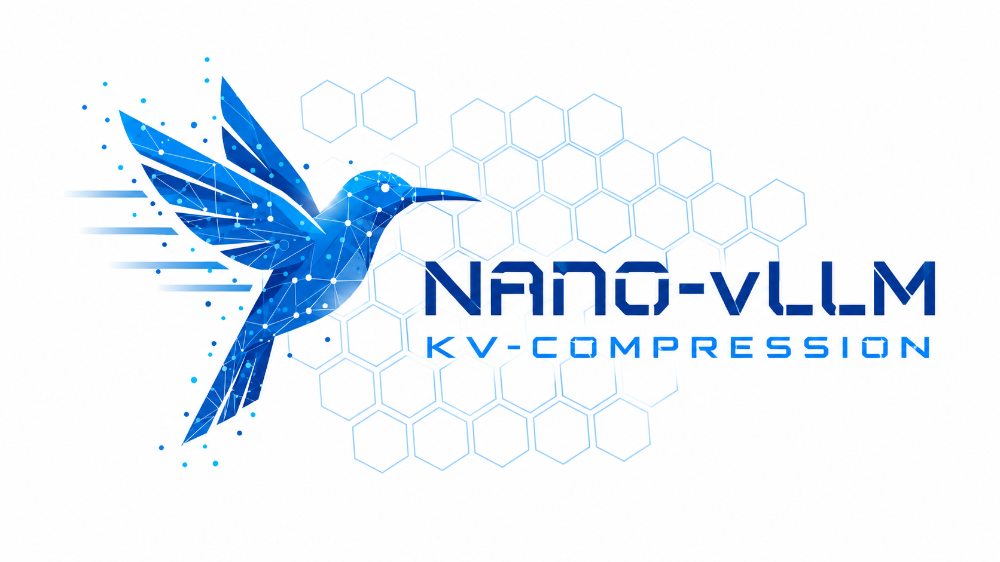

<p align="center">

</p>

<p align="center">
<a href="https://trendshift.io/repositories/15323" target="_blank"></a>
</p>

# Nano-vLLM

A lightweight vLLM implementation built from scratch.

## Key Features

* 🚀 **Fast offline inference** - Comparable inference speeds to vLLM
* 📖 **Readable codebase** - Clean implementation in ~ 1,200 lines of Python code
* ⚡ **Optimization Suite** - Prefix caching, Tensor Parallelism, Torch compilation, CUDA graph, etc.

## Installation

```bash
pip install git+https://github.com/GeeeekExplorer/nano-vllm.git
```

## Model Download

To download the model weights manually, use the following command:
```bash
huggingface-cli download --resume-download Qwen/Qwen3-0.6B \
  --local-dir ~/huggingface/Qwen3-0.6B/ \
  --local-dir-use-symlinks False
```

## Quick Start

See `example.py` for usage. The API mirrors vLLM's interface with minor differences in the `LLM.generate` method:
```python
from nanovllm import LLM, SamplingParams
llm = LLM("/YOUR/MODEL/PATH", enforce_eager=True, tensor_parallel_size=1)
sampling_params = SamplingParams(temperature=0.6, max_tokens=256)
prompts = ["Hello, Nano-vLLM."]
outputs = llm.generate(prompts, sampling_params)
outputs[0]["text"]
```

## Benchmark

Run `python3 bench.py --help` for offline benchmark options. For example:

```bash
python3 bench.py --model ~/huggingface/Qwen3-0.6B --num-seqs 256 --seed 0 --runs 3 --output results.json
python3 -m unittest discover -s tests -v
```

The benchmark excludes a short warmup and times each entire `LLM.generate` batch,
including prefill, decode, and host overhead; it does not measure TTFT or TPOT.
Throughput uses the actual returned output tokens. JSON reports individual runs,
median and nearest-rank p95 batch latency (sorted sample at `ceil(0.95 * runs)`,
using one-based indexing), and total output tokens divided by total measured time.
A local seeded generator creates a fresh workload for each run, so lengths vary
and results are reproducible for a given configuration and seed. Prefix caching
remains enabled, so incidental cache hits and other state across runs can affect
results; runs are not independent cold starts. The historical scores below were
measured separately and are not a claim about results from this script.

**Test Configuration:**
- Hardware: RTX 4070 Laptop (8GB)
- Model: Qwen3-0.6B
- Total Requests: 256 sequences
- Input Length: Randomly sampled between 100–1024 tokens
- Output Length: Randomly sampled between 100–1024 tokens

**Performance Results:**
| Inference Engine | Output Tokens | Time (s) | Throughput (tokens/s) |
|----------------|-------------|----------|-----------------------|
| vLLM           | 133,966     | 98.37    | 1361.84               |
| Nano-vLLM      | 133,966     | 93.41    | 1434.13               |


## Star History

[](https://www.star-history.com/#GeeeekExplorer/nano-vllm&Date)